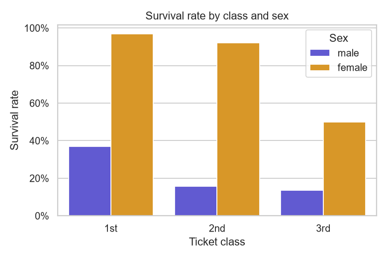

# Titanic Survival Predictor

Would you have survived the Titanic? Enter a passenger profile and a model trained on the real 1912 passenger list estimates the chance of survival.

**[Live demo →](https://ravshanovna-titanic.vercel.app)** — pick a class, sex, age, fare, family aboard, port and title, and get a survival probability instantly. The model runs in your browser (ONNX Runtime Web), no server needed.



## Results

Held-out test set (20%, 179 passengers):

| Metric | Score |
|---|---|
| ROC-AUC | **0.847** |
| Accuracy | 81.0% |
| Precision (survived) | 79.7% |
| Recall (survived) | 68.1% |
| F1 | 73.4% |

5×3 repeated stratified cross-validation on the training set (712 passengers):

| Model | ROC-AUC | F1 | Accuracy |
|---|---|---|---|
| **Gradient Boosting** (chosen) | 0.888 | 0.768 | 83.2% |
| Random Forest | 0.881 | 0.766 | 83.1% |
| Logistic Regression | 0.873 | 0.762 | 82.3% |

The test score is a little below the CV average; with only 179 test passengers a handful of hard cases moves it by several points, so the CV numbers are the more reliable estimate. Honest note: on top of the title, the family-size / fare-per-person features add only a little (Logistic Regression CV ROC-AUC 0.870 → 0.873).

## Key findings

- **Sex, title and class dominate.** Women survived far more often than men in every class; **97%** of 1st-class women survived vs **14%** of 3rd-class men.
- **Title is a strong engineered feature:** “Master” (boys) survived **57%** of the time vs **16%** for “Mr” — “women and children first” is visible in the data.
- **Family size matters non-linearly:** small families (2–4 people) survived 55–72% of the time, people travelling alone 30%, families of 5+ mostly under 35%.
- Higher fare per person (a proxy for cabin location and wealth) goes with higher survival.

## Approach

1. **Cleaning** — dropped `Cabin` (77% missing) and `Ticket` (free text); filled 2 missing ports with Southampton.
2. **Feature engineering**
   - *Title* extracted from the name (`"Braund, Mr. Owen Harris"` → `Mr`), French forms mapped, rare titles grouped.
   - *Missing ages* (177) filled with the median age of the same title, learned on the training split only.
   - *Family size*, *travelling alone* and *log fare per person* computed **inside the pipeline** by a small custom transformer (`features.py`) with its own ONNX converter — so the web form only asks for things a person can type, and the browser computes exactly the same features as training.
3. **Pipeline** — `ColumnTransformer` (one-hot encoding for categories, scaling for the linear model) + model, so nothing leaks between folds.
4. **Model selection** — Logistic Regression, Random Forest and Gradient Boosting compared with 5×3 repeated stratified CV.
5. **Evaluation** — one final check on the untouched test set: confusion matrix, ROC curve, permutation importance.
6. **Deployment** — the full pipeline is exported to ONNX and verified against scikit-learn (max difference ≈ 2e-7) before shipping to the static web app.

## Project structure

```
├── notebook.ipynb     # EDA, feature engineering, model comparison, evaluation (with outputs)
├── train.py           # reproducible training + ONNX export
├── features.py        # family-feature transformer + its ONNX converter
├── export_utils.py    # ONNX export / verification helpers
├── requirements.txt
└── web/               # static demo deployed on Vercel
    ├── index.html, app.js, style.css
    ├── model.onnx     # exported pipeline
    ├── meta.json      # form schema, metrics, comparison
    └── assets/        # charts
```

## Run locally

```bash
pip install -r requirements.txt
python train.py                         # downloads data, trains, writes web/model.onnx
python -m http.server 8000 -d web       # open http://localhost:8000
```

## Tech

Python · pandas · scikit-learn · matplotlib/seaborn · skl2onnx (custom converter) · ONNX Runtime Web · Vercel

**Dataset:** [Titanic passenger list](https://www.kaggle.com/competitions/titanic/data) (Kaggle training set, 891 passengers; mirrored [here](https://github.com/datasciencedojo/datasets)).
